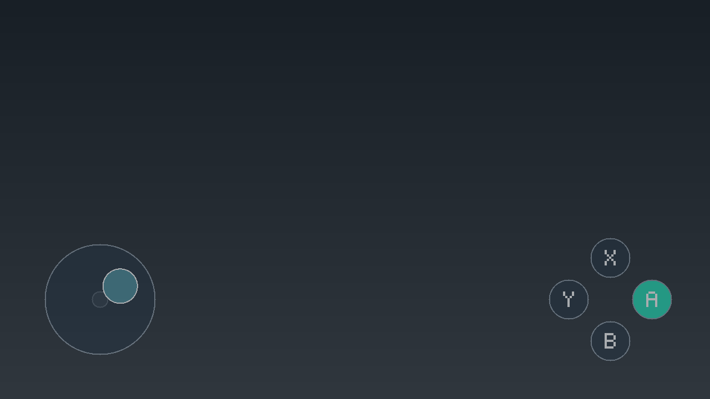

# Touchpad 0.1.1-rc10

启动失败排查现有独立工具 **Touchpad Diag 0.3.4**，安装及操作见 [诊断程序说明](docs/DIAGNOSTIC.md)。它先采集 System／Applet 真实配额，再由 A 键测试 Touchpad 后台；rc10 安装包已包含新版诊断 NRO。此版本尚未真机验证。

Switch OLED 屏幕触摸虚拟手柄：固定左摇杆、ABXY、多点触摸、Tesla 设置及独立后台显示。

**0.1.0 暂停安装：已收到 OLED（用户报告 HOS 22.5.0 / AMS 1.11.2 / E）开机 fatal 的反馈，移除本插件后台目录后恢复正常。具体根因尚未确认，电脑端测试不能代表真机可用。请勿重新安装 0.1.0 压缩包。**

仍安装 0.1.0 的用户请完全关机，将 SD 卡上的 `atmosphere/contents/4200000054504144` 备份到电脑后从卡中移除，安全推出 SD 卡，再启动主机。仅处理这个目录。调查记录见 [启动故障记录](docs/BOOT_FAILURE.md)。

当前 **0.1.1-rc10** 按用户选择，将绘图延迟与输入超时分开：触摸采样正常时持续输入，允许按键高亮和摇杆画面延迟，绘图恢复后无需重新启用。rc8 已由用户确认在游戏内显示及接收触摸；rc9 实机日志确认三次消失由绘图 250 ms 保护触发，当时采样正常。rc10 保留真实采样超时、HOME、休眠、切换游戏和实际显示错误的停止处理。修复效果待实机验证，见 [rc10 修复与测试](docs/RUNTIME_RC10.md)。



上图由实际控件绘制代码在电脑上生成，背景是示意色，不是真机截图。

## 安装

1. 将 `touchpad-0.1.1-rc10-sd.zip` 解压，把其中 `atmosphere` 和 `switch` 两个目录**合并**到 SD 卡根目录，不要删除原有目录。包内不包含大气层、Tesla Menu 或加载器替换文件。
2. 完整重启进入你现有的大气层。后台不会随系统启动；升级前务必移除旧模块目录，避免遗留 boot2.flag。
3. 进入游戏，用你原有的组合键打开 Tesla，选择 **Touchpad**，点击 **启动后台（本次开机）**。若显示启动失败，记录完整返回码，不要反复尝试。
4. 确认“显示层：已就绪”“错误码：00000000”，选择 **启用并返回游戏**。先抬起所有手指，再操作左下摇杆和右下 ABXY。
5. HOME 或 Tesla 唤出会停止输入；回到游戏后需重新手动启用。“关闭并断开虚拟手柄”还会断开虚拟控制器。

实际安装文件：

```text
atmosphere/contents/4200000054504144/exefs.nsp
switch/.overlays/touchpad.ovl
switch/touchpad-test/touchpad-test.nro
switch/touchpad-diag/touchpad-diag.nro
```

**不要创建 `flags/boot2.flag`。** 每次重启后需在 Tesla 手动启动后台；进程启动失败会显示返回码。后台进入主函数并挂载 SD 后会写入 `config/touchpad/startup.log`，进程创建失败时可能没有该日志。手动运行仍有故障可能，不代表已通过真机验收。

`exefs.nsp` 是后台模块的 ExeFS 包，直接放在上述目录，**不要当作游戏 NSP 安装**。

## 首次手柄连接

虚拟设备使用独立 Pro Controller，不合并实体 Joy-Con 输入，也不自动抢占玩家 1。

如果测试程序显示它不是 P1，先用实体手柄进入系统“手柄 → 更改握法／顺序”，打开 Tesla → Touchpad，选择“发送一次 L + R 并返回”。菜单关闭后会发送一次约 400 ms 的 L＋R，然后释放。确认系统中的玩家顺序，再返回游戏启用。

配对页面可能让系统主动断开虚拟设备；若显示连接错误，可重新打开 Touchpad，再次主动执行配对。若持续失败，请记录错误码，并按 [真机验收表](docs/HARDWARE_TEST.md) 反馈。此流程尚未经过本机型实测，不能据此保证所有游戏都能选到玩家 1。

## 使用与设置

- 摇杆固定中心，支持模拟幅度、死区和圆形限幅。触点被摇杆捕获后一直归属该摇杆，抬起释放。
- ABXY 使用 X 上、B 下、Y 左、A 右布局。滑入按钮即按下，滑出即释放；支持移动时按键，也支持多指组合。
- 不透明度 10%～80%（默认 40%）、大小 75%～125%（默认 100%）、死区 5%～30%（默认 15%）。选中设置行后用左右调整，也可按 A 调整。
- “保存设置”会写入 SD 卡；“启用并返回游戏”也会先保存。直接返回上层菜单不会保存未提交的修改。
- 设置存于 `config/touchpad/settings.ini`，并保留 `.bak` 恢复副本。包内不提供覆盖现有设置的默认文件。
- 仅绘图延迟时保持输入，恢复显示不需要重新启用；触摸采样停止更新达到 250 ms 仍停止输入。
- 开机、休眠恢复、游戏切换后不自动恢复触摸输入。系统弹窗出现时，请用 HOME 或 Tesla 停用；只在游戏画面中选择“启用”。

首版不包含右摇杆、肩键、十字键、加减键、布局拖动、宏或连发。L＋R 仅作配对辅助。需要这些键完成游戏操作时，当前布局无法替代完整手柄。

## 首轮测试

rc10 先按 [测试步骤](docs/RUNTIME_RC10.md) 打开输入测试程序，确认顶部 **Mode: APPLICATION**。按住 R 启动已安装游戏并进入 hbmenu；普通从相册打开为 APPLET 模式。后台可直接在 Tesla 启动；Diag 0.3.4 用于继续排查启动，未执行时显示 NOT LAUNCHED。

通过你的大气层配置，以**应用模式／全内存模式**启动 hbmenu，运行 **Touchpad Input Test**；不要使用相册 applet 模式进行首轮测试。程序上半部分显示应用实际收到的各玩家输入，下半部分显示后台状态和错误码。

打开 Tesla 启用 Touchpad，确认移动、A/B/X/Y、滑动切键、抬手释放与 HOME 停止行为。实体手柄的 `+` 可退出测试程序。再选择无需原生触摸、主要使用左摇杆和 ABXY 的离线游戏测试。

详见 [真机验收表及故障恢复](docs/HARDWARE_TEST.md)。

## 卸载与恢复

先关闭 Touchpad，再关机。删除本插件的 `atmosphere/contents/4200000054504144`、`switch/.overlays/touchpad.ovl` 和 `switch/touchpad-test` 后重启即可。可另外删除 `config/touchpad` 清除设置。

若安装后无法正常进入系统，关机后通过电脑移除该模块的 `flags/boot2.flag`，或移除整个 `4200000054504144` 目录再重启。不要删除其他模块。

若整个后台崩溃或系统失去响应，进程内超时保护无法继续运行；必要时重启主机恢复，不能将“有 watchdog”理解为进程崩溃后也能保证释放。

## 源码与构建

采用 GPL-2.0-or-later 分发，随安装包一并提供对应源码压缩包。第三方说明见 [THIRD_PARTY.md](THIRD_PARTY.md)。

- `make test`：电脑端 C++20 测试，启用 AddressSanitizer 与 UndefinedBehaviorSanitizer。
- `make build`：使用固定摘要的 ARM64 devkitPro Docker 镜像离线构建。
- `make package`：检查二进制结构并生成 SD 卡包、源码包和校验清单。

详细环境见 [构建说明](docs/BUILD.md)，实现接口和限制见 [设计说明](docs/DESIGN.md)，验证结果见 [验证记录](docs/VALIDATION.md)。
