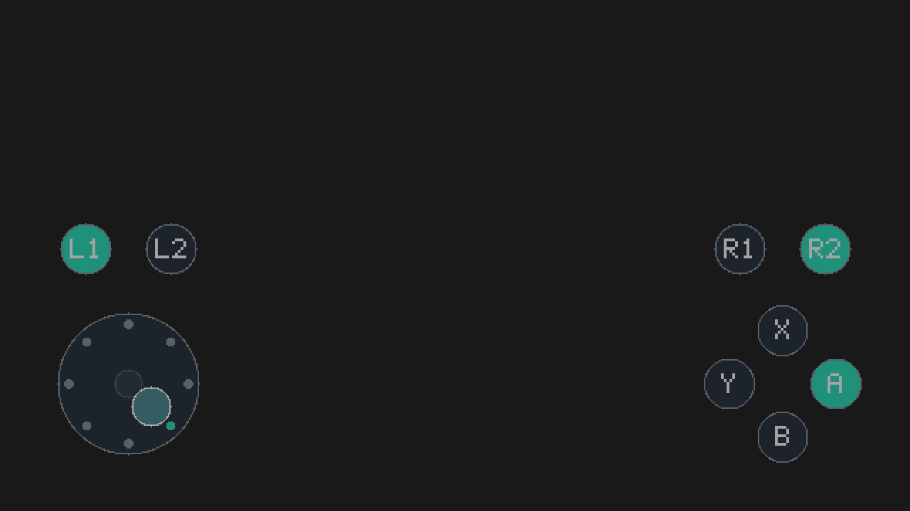

# Touchpad 1.1 Beta · 街机八方向、肩键与侧滑

当前开发版本为 **1.1.0-beta.2**。新增固定中心的街机八方向＋回中模式，可在 Tesla 与原模拟摇杆切换。操作方案参照用户指定的 iFBA 手感：等宽八方向、跨界立即切换，手指滑出外圈仍跟随方向，抬手或滑回中心区回中。详见 [街机摇杆说明](docs/ARCADE_STICK.md)。

已验证稳定基线保存在 **v1.0.0-beta.1**，其前后台运行问题已收到用户成功反馈；本次新功能的搓招手感及具体游戏兼容性尚待实机确认。支持固定左侧摇杆、ABXY、L1/L2/R1/R2、多点触摸、Tesla 设置和独立后台显示。本次增加肩键及隐藏中的 Touchpad 侧滑呼出，休眠恢复仍需实机确认。

安装包附带 Touchpad Input Test 和独立的 Touchpad Diag 0.3.4；本次升级须同时替换后台、菜单、输入测试程序，并完整重启，不能与旧协议版本混用。



上图来自实际 640×360 绘图缓冲，放大为屏幕逻辑尺寸；背景为示意色，不是真机截图。

## 安装

1. 将 `touchpad-1.1.0-beta.2-sd.zip` 解压，把其中 `atmosphere` 和 `switch` 两个目录**合并**到 SD 卡根目录，不要删除原有目录。包内不包含大气层、Tesla Menu 或加载器替换文件。
2. 升级前备份本插件文件，并移除本插件目录中的 `flags/boot2.flag`（若存在）。完整重启进入你现有的大气层；后台保持手动启动。
3. 进入游戏，用你原有的组合键或已开启的侧滑打开 Tesla，选择 **Touchpad**，点击 **启动后台（本次开机）**。若显示启动失败，记录完整返回码，不要反复尝试。
4. 确认“显示层：已就绪”“错误码：00000000”，选择 **启用并返回游戏**。先抬起所有手指，再操作左下摇杆、右下 ABXY 及两组上方的肩键。
5. HOME 或 Tesla 唤出会停止输入；回到游戏后需重新手动启用。“关闭并断开虚拟手柄”还会断开虚拟控制器。

实际安装文件：

```text
atmosphere/contents/4200000054504144/exefs.nsp
switch/.overlays/touchpad.ovl
switch/touchpad-test/touchpad-test.nro
switch/touchpad-diag/touchpad-diag.nro
```

**不要创建 `flags/boot2.flag`。** 每次重启后需在 Tesla 手动启动后台；进程启动失败会显示返回码。后台进入主函数并挂载 SD 后会写入 `config/touchpad/startup.log`，进程创建失败时可能没有该日志。后台及前台的已知问题已由用户确认修复，其余验收项目见发布说明。

`exefs.nsp` 是后台模块的 ExeFS 包，直接放在上述目录，**不要当作游戏 NSP 安装**。

## 无手柄侧滑呼出

这张 SD 卡的菜单为 Ultrahand，`config/ultrahand/config.ini` 的 `[ultrahand]` 下需设 `swipe_to_open=true`。本次代安装会保留其余内容，只开启该项；通用 ZIP 不覆盖全局菜单设置。

从屏幕最左边缘快速向右滑动，再抬手，可呼出菜单；Touchpad 隐藏时也支持同一手势。当前卡使用左侧菜单，原有 `ZL+ZR+DDOWN` 组合键继续可用。触摸菜单中的“启动后台（本次开机）”与“启用并返回游戏”即可使用。

休眠唤醒并回到游戏后，侧滑打开 Touchpad，选择“启用并返回游戏”；只有后台未运行时才需要再次启动后台。该手势不会替代主机的电源唤醒或系统解锁。其他第三方插件隐藏时是否支持侧滑取决于该插件；本次补齐的是 Touchpad，并启用现有主菜单的开关。实现和验收步骤见 [肩键与侧滑说明](docs/SHOULDERS_SWIPE.md)。

## 首次手柄连接

虚拟设备使用独立 Pro Controller，不合并实体 Joy-Con 输入，也不自动抢占玩家 1。

如果测试程序显示它不是 P1，先用实体手柄进入系统“手柄 → 更改握法／顺序”，打开 Tesla → Touchpad，选择“发送一次 L + R 并返回”。菜单关闭后会发送一次约 400 ms 的 L＋R，然后释放。确认系统中的玩家顺序，再返回游戏启用。

配对页面可能让系统主动断开虚拟设备；若显示连接错误，可重新打开 Touchpad，再次主动执行配对。若持续失败，请记录错误码，并按 [真机验收表](docs/HARDWARE_TEST.md) 反馈。此流程尚未经过本机型实测，不能据此保证所有游戏都能选到玩家 1。

## 使用与设置

- 摇杆固定中心，模拟模式支持连续幅度、死区和圆形限幅；街机模式提供八方向和回中。触点被摇杆捕获后一直归属该摇杆，抬起释放。
- L1/L2 位于左侧摇杆上方，R1/R2 位于右侧 ABXY 上方；分别输出 Switch 的 L/ZL/R/ZR，不提供 L3/R3。支持同时按住肩键、ABXY 与方向。
- ABXY 使用 X 上、B 下、Y 左、A 右布局。滑入按钮即按下，滑出即释放；支持移动时按键，也支持多指组合。
- 不透明度 10%～80%（默认 40%）、大小 75%～125%（默认 100%）、死区 5%～30%（默认 15%）。选中设置行后用左右调整，也可按 A 调整。
- “保存设置”会写入 SD 卡；“启用并返回游戏”也会先保存。直接返回上层菜单不会保存未提交的修改。
- 设置存于 `config/touchpad/settings.ini`，并保留 `.bak` 恢复副本。v1 设置可自动读取，保存后升级为 v2；回退旧版时请恢复旧设置备份。包内不提供覆盖现有设置的默认文件。
- 仅绘图延迟时保持输入，恢复显示不需要重新启用；触摸采样停止更新达到 250 ms 仍停止输入。
- 开机、休眠恢复、游戏切换后不自动恢复触摸输入。系统弹窗出现时，请用 HOME 或 Tesla 停用；只在游戏画面中选择“启用”。

本版不包含右摇杆、L3/R3、加减键、独立十字键按钮、布局拖动、宏或连发；街机摇杆可输出十字键。

## 街机摇杆

1. 在 Tesla → Touchpad 把“摇杆模式”改成“街机八方向”。
2. “街机输出”先用“十字键”；若目标游戏或模拟器只接受摇杆方向，切换为“左摇杆”再试。
3. “街机回中区”默认 20%。减小会更容易出方向，增大会更容易回中；“模拟摇杆死区”只影响模拟模式。
4. 选择“启用并返回游戏”，抬起全部手指后操作。可直接点方向区，连续滑动完成下→右下→右等方向输入；回到中心或抬手释放。

控件保持固定位置，街机模式用八个方向标记及九位置摇杆头显示当前状态。ABXY 位置保持原样，肩键在两侧操作区上方。

## 首轮测试

首次使用可按 [验收步骤](docs/HARDWARE_TEST.md) 打开输入测试程序，确认顶部 **Mode: APPLICATION**。按住 R 启动已安装游戏并进入 hbmenu；普通从相册打开为 APPLET 模式。后台可直接在 Tesla 启动；Diag 0.3.4 用于继续排查启动，未执行时显示 NOT LAUNCHED。

通过你的大气层配置，以**应用模式／全内存模式**启动 hbmenu，运行 **Touchpad Input Test**；不要使用相册 applet 模式进行首轮测试。程序上半部分显示应用实际收到的各玩家输入，下半部分显示后台状态和错误码。

打开 Tesla 启用 Touchpad，确认移动、A/B/X/Y、L1/L2/R1/R2、滑动切键、抬手释放与 HOME 停止行为。实体手柄的 `+` 可退出测试程序。再选择无需原生触摸、主要使用左摇杆和 ABXY 的离线游戏测试。

详见 [真机验收表及故障恢复](docs/HARDWARE_TEST.md)。

## 卸载与恢复

先关闭 Touchpad，再关机。删除本插件的 `atmosphere/contents/4200000054504144`、`switch/.overlays/touchpad.ovl` 和 `switch/touchpad-test` 后重启即可。可另外删除 `config/touchpad` 清除设置。

若安装后无法正常进入系统，关机后通过电脑移除该模块的 `flags/boot2.flag`，或移除整个 `4200000054504144` 目录再重启。不要删除其他模块。

若整个后台崩溃或系统失去响应，进程内超时保护无法继续运行；必要时重启主机恢复，不能将“有 watchdog”理解为进程崩溃后也能保证释放。

## Git 与发布

- `v1.0.0-beta.1`：已保存的稳定 Beta 基线；街机摇杆在 `feat/arcade-stick` 分支开发。
- `v0.1.1-rc10`：用户确认可用的原始源码基线。
- 安装包、匹配源码包和 SHA-256 清单位于 `dist/`；构建输出、下载环境和实机原始日志不纳入 Git。
- 0.1.0 曾出现启动故障，已停止分发；历史记录见 [BOOT_FAILURE.md](docs/BOOT_FAILURE.md)。

## 源码与构建

采用 GPL-2.0-or-later 分发，随安装包一并提供对应源码压缩包。第三方说明见 [THIRD_PARTY.md](THIRD_PARTY.md)。

- `make test`：电脑端 C++20 测试，启用 AddressSanitizer 与 UndefinedBehaviorSanitizer。
- `make build`：使用固定摘要的 ARM64 devkitPro Docker 镜像离线构建。
- `make package`：检查二进制结构并生成 SD 卡包、源码包和校验清单。

详细环境见 [构建说明](docs/BUILD.md)，实现接口和限制见 [设计说明](docs/DESIGN.md)，验证结果见 [验证记录](docs/VALIDATION.md)。
