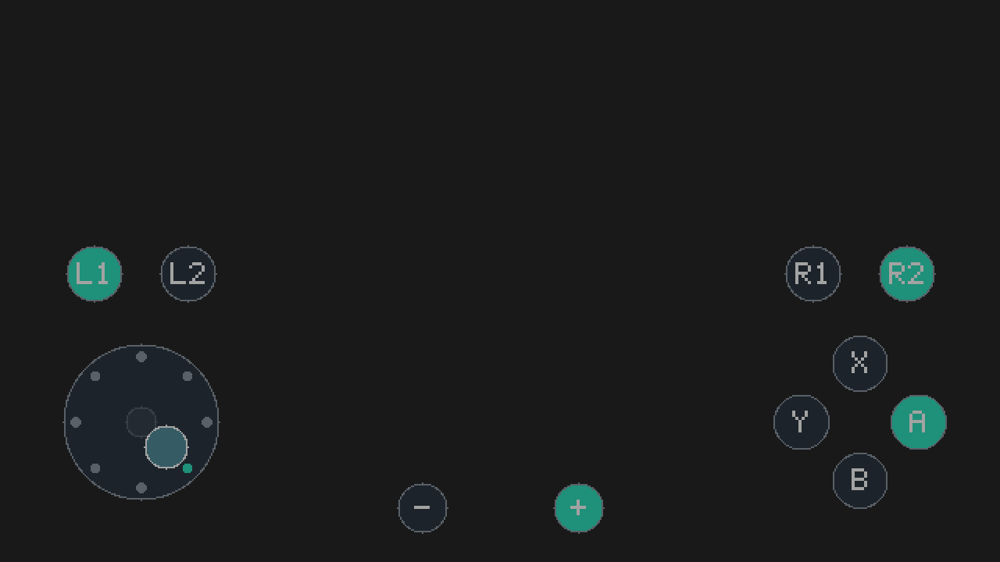

# 1.1.0-beta.3：加减键

2026-10-02，按用户要求增加 ＋／－，并评估 HOME／截图；用户明确表示有冲突时只加入加减键。

## 行为

- 屏幕底部中间，左侧为 －（Minus），右侧为 ＋（Plus）。
- 固定逻辑中心分别为 `(540,650)` 和 `(740,650)`，默认半径 32，随控件大小 75%～125% 缩放；位置不可拖动。
- 沿用普通按键：触摸或滑入时按下，滑出或最后一个触点抬起时释放，可与方向、ABXY、肩键组合。
- Plus 使用 HID bit 10，Minus 使用 bit 11；IPC／设置继续使用 v2。未改变侧滑、后台线程、显示层切换、Applet 内存池或自动启动策略。
- 输入测试程序增加 `+:0/1` 和 `-:0/1` 显示。退出改为同时按住 ＋ 和 － 两秒，单键和短按组合不会退出。任一键释放、时钟回退或轮询中断会重新计时；游戏中的加减键不受此测试程序退出规则影响。

实际半分辨率绘图预览：

## HOME／截图的评估

当前固定工具链 libnx 4.12.0 的 [hiddbg.h](https://github.com/switchbrew/libnx/blob/v4.12.0/nx/include/switch/services/hiddbg.h) 定义了 `HiddbgNpadButton_Home` 与 `HiddbgNpadButton_Capture`，并可用于 HDLS 状态。这说明接口存在，不等同于本插件已经可靠支持。

现有后台 `sampler` 读取 HOME 状态后将 `Sample::home` 设为真；`Engine::tick` 随即暂停并清空全部虚拟输入。因此，将 HOME 直接加入普通触摸映射会在识别 HOME 后释放其自身注入，并终止触摸手柄运行，无法像其他按钮一样保持到抬手。长按 HOME 和返回游戏的流程需单独设计、在本机实测。短按能否稳定触发系统动作也不能仅凭代码保证。

没有从当前代码中发现 Capture 会直接触发同一暂停条件，但截图／录像及叠加层的具体表现未验证。按照用户“有冲突就只添加 ＋／－”的回退要求，本轮不加入 HOME 或 Capture，也不绕开原有 HOME 停止保护。不能据此断言这些系统键永远无法实现。

## 验证与安装

六组 ASan／UBSan 测试通过，包括新增按键位、模拟／街机模式组合、多指同键释放、滑动切键、最小／默认／最大布局间距、帧缓冲边界、HOME／休眠／Tesla／应用切换后归零，以及测试程序退出的两秒边界和重新计时。已查看实际绘图预览。

离线 Switch 编译和结构检查通过：后台镜像加主线程栈仍为 5,066,752 字节（4.8320 MiB），低于既有 5 MiB 检查阈值。以上不是实机按键验收。

安装 `touchpad-1.1.0-beta.3-sd.zip` 中对应文件并完整重启。此前的侧滑开关和 Touchpad 设置无需修改。真机先在应用模式 Input Test 中分别触摸加减键，确认按下为 1、抬起为 0、单独 ＋ 不退出，再检查游戏暂停／菜单功能与同时长按两键退出测试程序。
